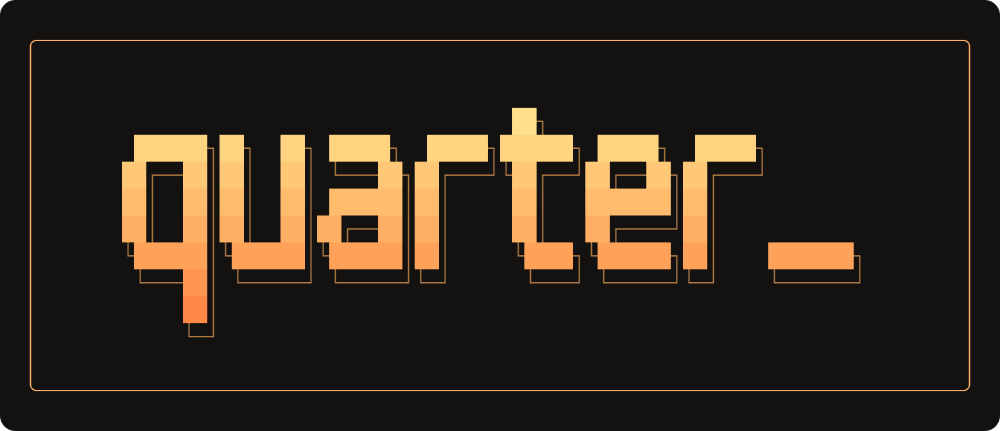
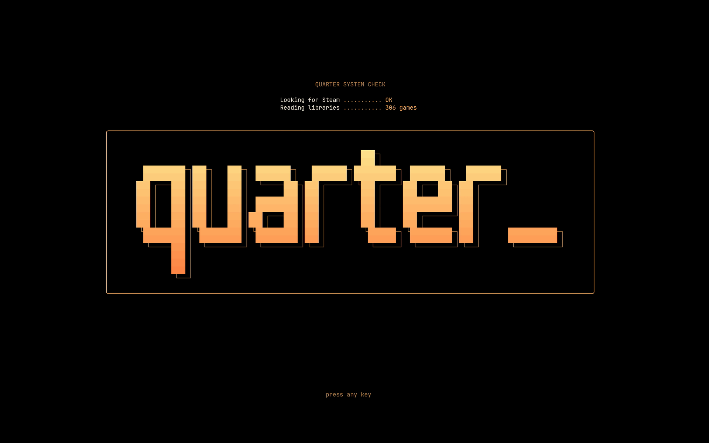
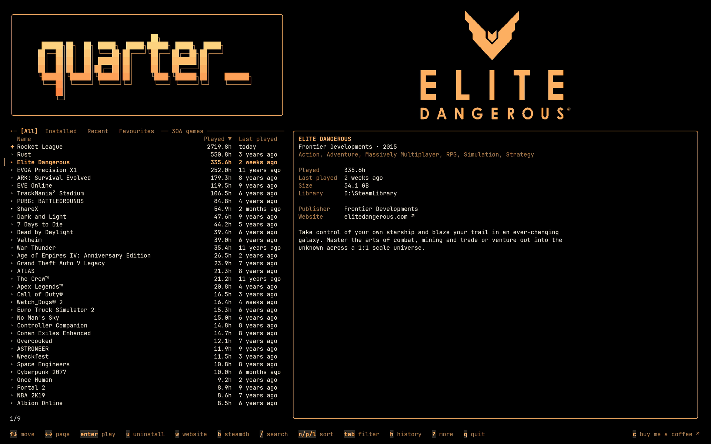
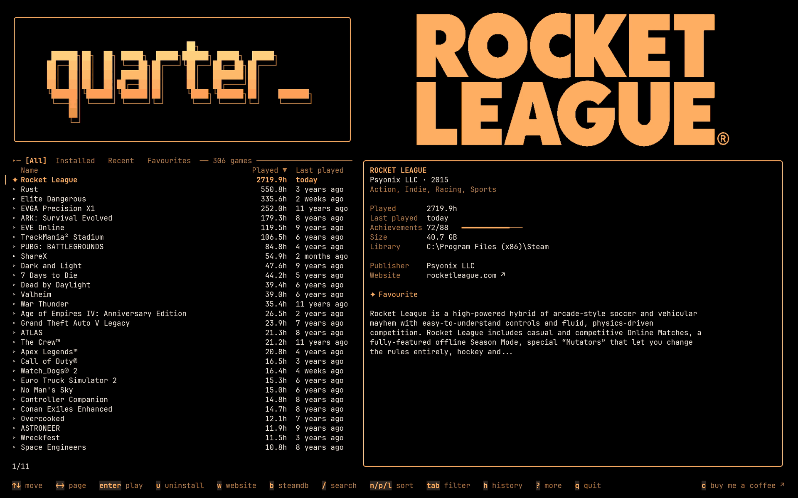
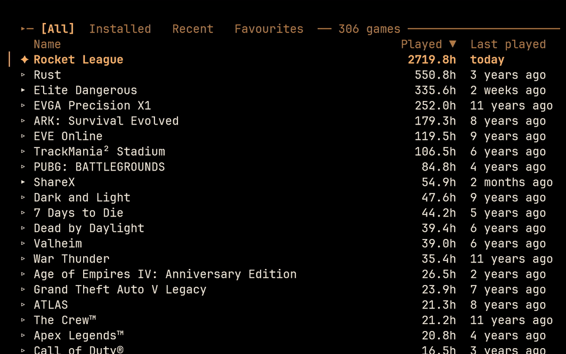
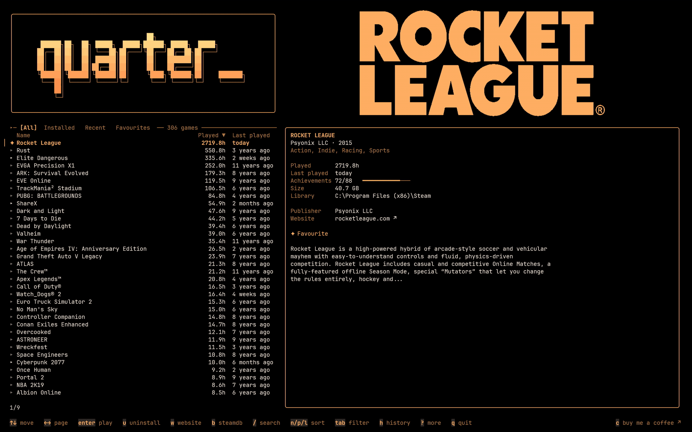
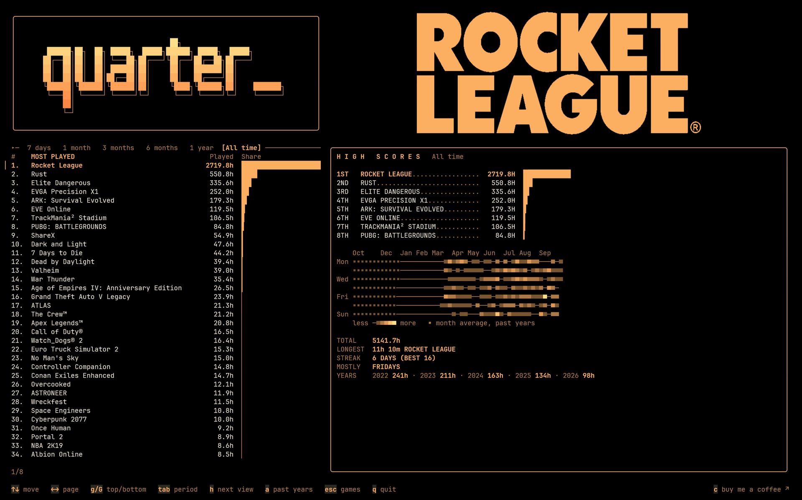
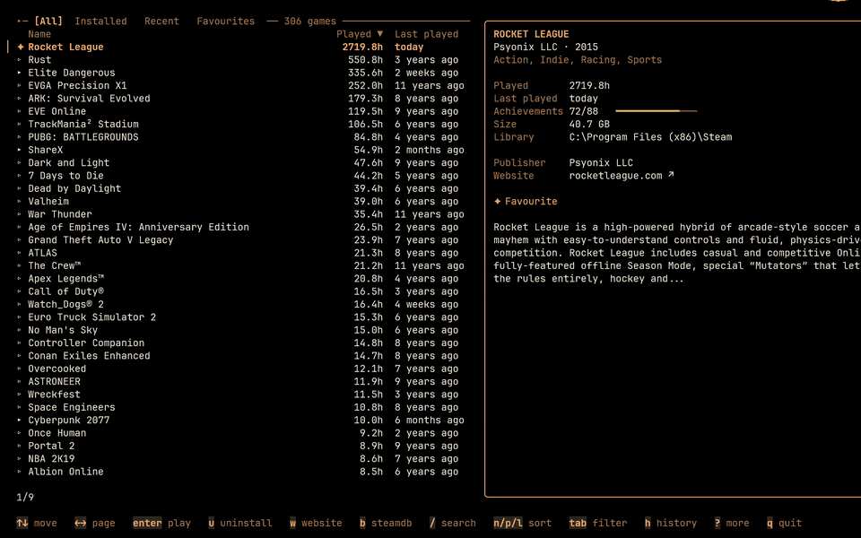

<h1 align="center">
  
</h1>

<p align="center">
  A fast terminal app to browse, search and launch your Steam library.<br>
  Insert a quarter, pick a game, press Enter.
</p>

<p align="center">
  <a href="https://github.com/stronxyo/quarter/releases/latest"></a>
  <a href="https://github.com/stronxyo/quarter/actions/workflows/ci.yml"></a>
  <a href="LICENSE"></a>
</p>

<!-- VIDEO: replace this line with the github.com/user-attachments/assets/... link of quarter-readme.mp4 -->

Quarter sits on top of the Steam client you already have. It reads your library from Steam's own files and hands every action back to Steam, so there is no login, no password and nothing that touches your account. Steam still does the downloads, updates, cloud saves and overlay.

## Features

- **Your whole library in one list:** installed games and the ones you own but haven't installed, with playtime, last played and achievements.
- **Search as you type** with `/` (the words you type, in any order, best matches first), sort by name, playtime or last played, and filter: All, Installed, Recent, Favourites.
- **Game logos as real pictures** in terminals that draw Sixel graphics, and as one-colour block art everywhere else.
- **A details pane:** developer, year, genres, achievements, size, library folder, publisher and the official website.
- **Play history:** your sessions recorded from Steam's log, a ranking by period, a HIGH SCORES board with a calendar of played days, and, if you ask for them, your past years from Steam Replay.
- **Steam starts quietly:** on Windows, Quarter starts Steam in the tray as it opens, and games start without Steam's window.
- **Live Steam state:** a game running now, downloads and updates with their progress, games installed or uninstalled while Quarter is open.
- **Arcade touches:** an intro on start, an attract mode while the start screen waits, a goodbye when you quit.
- **Keyboard first, mouse welcome:** every action has a key, and the mouse works too.

## A quick tour

### Insert a quarter

Quarter opens with an arcade intro, checks for Steam, reads your libraries and waits for a key.



### Your whole library

Every game you own in one list, with its playtime and last played. The selected game's logo and details sit beside it.



### Search as you type

Press `/` and type. The list narrows with every letter, and the logo and details follow the game on top.



### Sort and filter, one key each

`p` sorts by playtime, and `tab` steps through All, Installed, Recent and Favourites.



### Your play history and HIGH SCORES

`h` opens the ranking of what you played most, and `h` again the HIGH SCORES board with a calendar of played days. `tab` changes the period, from 7 days to all time.





### Press Enter

Enter hands the game to Steam, and its row shows it running.



## Install

Quarter needs a terminal and the Steam client installed. Nothing else.

Windows (PowerShell):

```
irm https://raw.githubusercontent.com/stronxyo/quarter/main/install.ps1 | iex
```

or with winget (a few days after each release, once Microsoft has reviewed it):

```
winget install stronxyo.Quarter
```

macOS and Linux:

```
curl -fsSL https://raw.githubusercontent.com/stronxyo/quarter/main/install.sh | sh
```

or with Homebrew (`brew install stronxyo/tap/quarter`).

With Go installed:

```
go install github.com/stronxyo/quarter/cmd/quarter@latest
```

You can also download a build for your system from the [releases page](https://github.com/stronxyo/quarter/releases).

Then run `quarter`.

**Tested on:** Windows 11 with Windows Terminal. The macOS and Linux builds are made from the same code and should work, but haven't been tested on a real machine yet. Reports are welcome in the [issues](https://github.com/stronxyo/quarter/issues).

## Keys

| Key | What it does |
|---|---|
| `↑` `↓` | Move |
| `←` `→`, `pgup` `pgdown` | Page |
| `g` `G`, `home` `end` | Top, bottom |
| `enter` | Play, or install a game that isn't installed |
| `i` | Install |
| `u` | Uninstall (press twice) |
| `s` | The game's store page in Steam |
| `w` | The game's official website, when it has one |
| `b` | The game's page on SteamDB |
| `f` | Favourite |
| `c` | Buy me a coffee (opens Ko-fi) |
| `/` | Search (`esc` clears it) |
| `n` `p` `l` | Sort by name, played, last played (again to flip) |
| `tab` | Next filter |
| `h` | History: the ranking, then the HIGH SCORES board, then back |
| `a` | In history: add or remove your past years from Steam Replay |
| `d` | Show or hide the details pane |
| `o` | Show or hide game logos |
| `r` | Rescan the library |
| `?` | All keys |
| `q` | Quit (`ctrl+c` also works) |

The key line at the bottom shows only what the selected game allows: no `i` for an installed game, no `w` for a game without a website.

### Mouse

Click a game to select it, double-click to play or install it. The filter tabs, the column names (sort), the keys on the key line, the website in the details pane, the game's logo (opens the game in your Steam library), the quarter_ box (an intro) and "buy me a coffee" in the bottom-right corner all click. Right-click stars a game. The wheel moves through the list.

While Quarter has the mouse, hold `Shift` to select and copy text the usual way. To leave the mouse to the terminal, set `"mouse": "off"` in the settings.

## Pictures

Game logos are drawn as real pictures in terminals that support Sixel graphics: Windows Terminal 1.22 or later (tested), and by their documentation WezTerm, iTerm2, foot, Konsole and mlterm. Other terminals, including Kitty and Ghostty for now, get the logos as block art in one colour. Quarter finds out on its own; there is nothing to set.

The classic Windows console (the old black window, still the default on Windows 10) has no way to draw them cleanly, so there Quarter shows no game logos and swaps a few characters its fonts lack for ones they have. Everything else works the same. For the logos, use [Windows Terminal](https://aka.ms/terminal), free from Microsoft and the default on Windows 11.

Logos come from Steam's own cache on your computer first, and from Steam's servers for games that aren't there.

## Settings

Quarter remembers your favourites, sort, filter and what you hid in `config.json`, in its data folder:

- Windows: `%APPDATA%\quarter`
- macOS: `~/Library/Application Support/quarter`
- Linux: `~/.config/quarter` (or `$XDG_CONFIG_HOME/quarter`)

A few settings are only in the file. Close Quarter before editing it.

| Setting | Values |
|---|---|
| `"intro"` | `""` a random intro (default), `"off"`, or one intro by name |
| `"goodbye"` | `""` a random goodbye (default), `"off"`, or one goodbye by name |
| `"mouse"` | `""` Quarter takes the mouse (default), `"off"` leaves it to the terminal |
| `"logo_blocks"` | `"octants"` for twice the detail, in fonts that have block octants (Windows Terminal's own Cascadia Mono) |
| `"glyphs"` | `""` found out (default), `"basic"` the classic console's way (no game logos, simpler characters), `"full"` every character |
| `"steam_start"` | `""` Steam starts in the tray when Quarter opens, and games start without its window (default, Windows); `"normal"` Steam opens with its window, as before |

**Steam starts quietly (Windows).** Most games need Steam running. So when you open Quarter with Steam closed, Quarter starts Steam in the tray, with no window, and a game you play starts without Steam's window covering the terminal. Steam needs about half a minute to sign in; play during that time and the message under the details says "Opening Steam" until the game starts. Install, uninstall, the store page and the logo click still show Steam's window. Quitting Quarter leaves Steam in the tray. To have Steam open as it always has, with its window and only when you play, close Quarter, open `config.json` (Windows: `%APPDATA%\quarter\config.json`) in a text editor, and change `"steam_start":""` to `"steam_start":"normal"`; set it back to `""` for the quiet start. On macOS and Linux, Quarter opens Steam as before.

Intros: `crt-power-on`, `implode`, `coin-drop`, `staggered-drop`, `raster-reveal`, `typewriter`, `decode`, `light-sweep`, `dither-dissolve`, `glitch-settle`, `starfield-warp`, `beams`, `slice`, `stack-up`, `spiral-in`, `ignite`, `rally`, `coin-roll`, `block-drop`, `march`, `snake`, `plasma`, `fire`, `code-rain`, `card-flip`, `synthwave`, `installer`, `shockwave`, `liquid-fill`, `neon`, `firework`, `zoom-punch`.

Goodbyes: `keep-the-change`, `quarter-returned`, `out-of-quarters-already`, `thanks-for-the-quarter`, `shutting-down`, `session-saved`, `its-now-safe-to-close-your-terminal`, `thanks-for-playing`, `high-score-saved`, `powering-down`, `see-you-next-round`.

Command line:

| Option | What it does |
|---|---|
| `--steam-path <folder>` | Use this Steam folder instead of finding it |
| `--list` | Print your installed games as plain text and exit |
| `--version` | Print the version and exit |

## Your data

Quarter keeps everything on your computer, asks Steam's public store and servers only for game details, logos and, if you ask, your past years, and sends nothing anywhere else. No account, no tracking. The full list is in [PRIVACY.md](PRIVACY.md).

To remove Quarter completely, delete the `quarter` program and its data folder (above).

## Why "Quarter"

In a famous story about a giant virtual world, a player named Parzival plays a perfect game of Pac-Man and wins a quarter: an extra life that later saves him in the final battle. A quarter is also what you drop into an arcade machine to start playing, which is what this app does for your games.

## Support

[](https://ko-fi.com/M2B82831Z2)

Quarter is free and always will be. If it makes your library a nicer place, you can buy me a coffee on [Ko-fi](https://ko-fi.com/stronxyo) (or press `c` in Quarter, or click "buy me a coffee" in its bottom-right corner).

## Not affiliated with Valve

Quarter is an independent project, not made, endorsed or supported by Valve. Steam and the Steam logo are trademarks of Valve Corporation. Game names, logos and details belong to their owners; Quarter reads them from your Steam client and Steam's public servers and shows them as they are, without any guarantee.

## License

[MIT](LICENSE)
